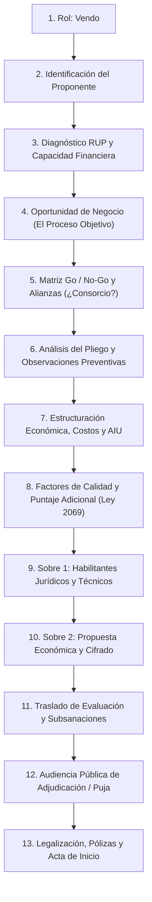

# 🏛️ ORDEN RONDA 6: DESARROLLO DE LA RUTA «VENDO» (EL FLUJOGRAMA DEL LICITANTE Y CONTRATISTA)
**Destinatario:** Cowork / Claude Tester  
**Proyecto:** *ProcureSim v2.0 - Simulador de Entrenamiento en Contratación Pública Colombiana*  
**Ubicación de trabajo:** `c:\Users\Carmelo\Documents\simmulador par entrenamiento en contratacion publica`  
**Fecha de emisión:** Noviembre 2026  

---

## 📌 VISIÓN: LA MISMA FILOSOFÍA, AHORA DESDE LA MIRADA DEL LICITANTE
Hasta la Ronda 5, el Flujograma (`ContractFlowchartView.tsx`) desarrolló magistralmente la ruta **«Compro»** (el funcionario público que estructura, publica y liquida un contrato).

Si el usuario elige **«Vendo»** en el Paso 1:
> *«Soy empresa proveedora, contratista, Mipyme o licitante. Quiero competir, blindar mi propuesta, evitar ser descalificado y ganar contratos con el Estado y el sector privado.»*

Hoy el flujo lo llevaba erróneamente por las preguntas del comprador (pedir CDP, autoría del funcionario, etc.).  
**Misión de esta ronda:** Construir la ruta paralela **«Vendo»** bajo la **misma filosofía de diseño** (*Interacción Humana Progresiva*):
1. **Lienzo blanco, sereno y limpio:** Cero saturación visual. Pregunta a pregunta se va armando el expediente licitatorio.
2. **"Tu complejidad, no la mía":** Los motores de auditoría RUP, cálculo de capacidad residual K, matrices de experiencia UNSPSC y fórmulas de puntaje corren de fondo.
3. **Persistencia total en «Mis Expedientes»:** Cada propuesta licitatoria se autoguarda a los 350 ms, se puede reanudar, duplicar y exportar en `.json`.
4. **Cero alucinaciones:** Verdad documental. Si un paz y salvo o un RUP está vencido, se declara francamente como *«Requiere subsanación»*.
5. **Salida documental real:** Descarga de la **Propuesta Licitatoria Integral en Word (`.docx`)**.

---

## 🧭 LA RUTA DEL LICITANTE: 13 PASOS PROGRESIVOS

### Detalle de cada paso de la Ruta «Vendo»:

1. **Paso 1 — Rol:** El usuario selecciona **«Vendo»**.
2. **Paso 2 — ¿Quién se postula? (Identificación del Proponente):**  
   - Persona Natural, Jurídica o Estructura Plural (Consorcio / UT).  
   - Razón social, NIT, representante legal.  
   - Clasificación empresarial: Gran empresa vs Mipyme nacional (Ley 2069 / Dec. 1860).
3. **Paso 3 — Diagnóstico RUP y Salud Financiera:**  
   - ¿Cuenta con RUP renovado en Cámara de Comercio?  
   - Indicadores financieros automáticos: Liquidez (>= 1.2), Endeudamiento (<= 70%), Cobertura de intereses (>= 2.0).  
   - Clasificación de códigos UNSPSC que ofrece la empresa.
4. **Paso 4 — Oportunidad de Negocio (Proceso Objetivo):**  
   - ¿A qué proceso vas a ofertar? (Número, Entidad Compradora, Presupuesto Oficial y Modalidad).  
   - Plataforma de radicación sugerida (SECOP II, Suplos, TVEC, SAP Ariba, etc.).
5. **Paso 5 — Matriz Go / No-Go y Alianzas:**  
   - ¿Nos presentamos solos o nos aliamos?  
   - Si la empresa no alcanza la experiencia en SMMLV o la capacidad residual K: sugerir asociarse en **Consorcio o Unión Temporal** (conectando con `ConsortiumEngine`).
6. **Paso 6 — Blindaje del Pliego (Observaciones al Borrador):**  
   - ¿El pliego tiene "requisitos sastre" o condiciones desproporcionadas?  
   - Redactor automático de observaciones jurídicas pidiendo aclaración o subsanación de condiciones excluyentes antes del cierre.
7. **Paso 7 — Estructuración de Precio, Costos y AIU:**  
   - Costos directos + AIU (Administración, Imprevistos, Utilidad).  
   - Análisis de la fórmula económica del pliego (Media Geométrica, Mediana, etc.) para fijar la postura óptima.  
   - Semáforo preventivo de **Precio Artificialmente Bajo** para evitar descalificación.
8. **Paso 8 — Factores de Puntuación Adicional (Puntos Clave):**  
   - Puntos de Industria Nacional (Ley 816 de 2002: +10 a +20 puntos).  
   - Vinculación de personal con discapacidad (+1 punto), mujeres víctimas de violencia o reincorporados.  
   - Acreditación de Mipyme para desempate prioritario (Art. 35 Ley 2069).
9. **Paso 9 — Integración del Sobre 1 (Requisitos Habilitantes):**  
   - Garantía de Seriedad de la Oferta (compañía de seguros, vigencia y valor asegurado del 10%).  
   - Paz y salvo parafiscales y seguridad social (Art. 50 Ley 789 de 2002 firmado por Revisor Fiscal o Contador).  
   - RUP y certificaciones de experiencia en códigos UNSPSC.
10. **Paso 10 — Integración del Sobre 2 (Oferta Económica) y Cifrado:**  
    - Carta de presentación de la oferta económica.  
    - Desglose de precios unitarios e IVA.  
    - Simulación de cifrado criptográfico y radicación en la plataforma activa (SECOP II / Suplos / Ariba).
11. **Paso 11 — Informe de Evaluación y Término de Traslado (Subsanación):**  
    - Publicación del informe: ¿saliste Habilitado o "Por Subsanar"?  
    - Simulador del término legal de traslado (5 días hábiles): redactor del memorial de subsanación y observaciones a las ofertas de los competidores.
12. **Paso 12 — Audiencia Pública de Adjudicación / Evento de Puja:**  
    - Simulación de la audiencia: desempates en vivo si aplica, lectura de puntajes y resolución de adjudicación a favor del proponente.
13. **Paso 13 — Perfeccionamiento del Contrato y Acta de Inicio:**  
    - Constitución de la Garantía Única de Cumplimiento (cumplimiento, anticipo, salarios, calidad).  
    - Firma del contrato electrónico y suscripción formal del **Acta de Inicio** para empezar a facturar.  
    - Botón: **«Descargar Propuesta Licitatoria Integral Blindada (.docx)»**.

---

## 🛠️ TAREA TÉCNICA Y ARQUITECTURA
1. **Bifurcación Limpia en `ContractFlowchartView.tsx`:**  
   - Mantener el componente unificado o modularizar la vista de la ruta «Vendo» para que comparta el mismo shell visual, la cabecera limpia, el autoguardado a 350 ms y la bandeja de «Mis Expedientes».
   - En `Expediente`, `tipoOperacion: 'VENDO'` ya existe en `src/core/domain/expedientes.ts`.
2. **Reutilización de Motores Existentes:**  
   - Conectar con `ProposalAssistantEngine.ts` (ya contiene auditoría jurídica, financiera y técnica de ofertas).  
   - Conectar con `FinancialEngine.ts`, `ConsortiumEngine.ts`, `ScoringFormulasEngine.ts` y `TieBreakEngine.ts`.
3. **Descargable en Word (.docx):**  
   - Crear generador de la Propuesta Integral en `.docx` (Carta de presentación, oferta económica, certificaciones y cuadro de cumplimiento).

---

## 📋 ENTREGABLES EXIGIDOS A COWORK / CLAUDE
1. **Compilación en Limpio:** Ejecutar `npm run build` certificando **0 errores de TypeScript**.
2. **Pruebas en Navegador (Playwright):**
   - Recorrer la ruta «Vendo» completa del Paso 1 al 13.
   - Verificar que al recargar la página conserve el estado de la propuesta.
   - Comprobar la descarga del `.docx` de la propuesta.
3. **Actualización del Informe:**
   - Registrar la sección **«RONDA 6 — Ruta Vendo»** en `resultados_pruebas_cowork/INFORME_BATERIA_SIMULACIONES_COWORK.md`.
4. **Regeneración del Bundle:**
   - Actualizar `ProcureSim_portatil.html` con todos los cambios incorporados.

---
*¡Inicia la construcción de la Ruta Vendo bajo la misma filosofía humana y progresiva!*
